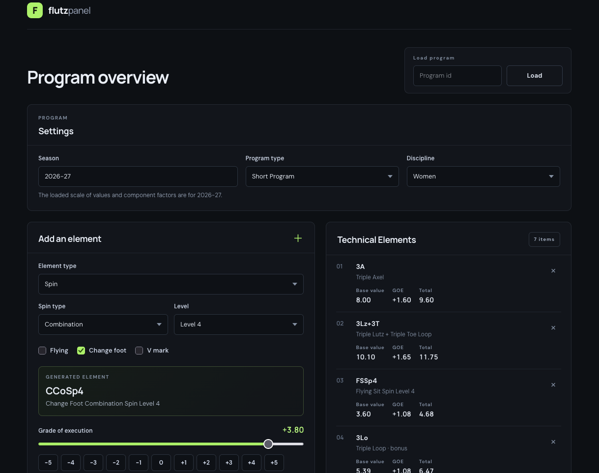

# FlutzPanel

A figure skating scoring application built to make creating and reviewing skating programs easier.

FlutzPanel is a full-stack web application that lets users build figure skating programs, add technical elements, enter program component scores, and apply deductions. As changes are made, the application updates the score breakdown so users can see how each part contributes to the overall result.

I started this project to combine my interest in figure skating with my interest in software development.

## Application Screenshot



## Features

- Create programs for different skating disciplines and program types.
- Add technical elements, including jumps, spins, step sequences, and choreographic elements.
- Enter Grade of Execution (GOE) values for technical elements.
- Adjust program component scores.
- Add deductions to a program.
- View score calculations and element breakdowns as program details change.
- Save programs and retrieve them through the backend API.


## Technologies

- **Frontend:** React, TypeScript, Vite, CSS
- **Backend:** Java, Spring Boot, Spring Data JPA
- **Database:** PostgreSQL


## How It Works

The application is organized into three main parts:

- **Frontend:** React and TypeScript handle the interface and user interactions. The frontend also provides a live scoring preview as users edit a program.
- **Backend:** The Spring Boot application provides the REST API used to save, retrieve, update, and delete programs, and to calculate scores for saved programs.
- **Database:** PostgreSQL stores program information.

The frontend communicates with the backend through HTTP requests.

## Running the Project Locally


### Requirements

- Java
- Node.js and npm
- PostgreSQL


### 1. Clone the repository

```bash
git clone YOUR_GITHUB_REPOSITORY_URL
cd flutzpanel
```


### 2. Set up the database

Create a PostgreSQL database named `flutzpanel`.

The backend needs a database connection configured in its application properties. Local database credentials should be kept out of the public repository. See the project's configuration before starting the backend.

### 3. Start the backend

From the project root directory, run:

```bash
./mvnw spring-boot:run
```

The backend runs at:

`http://localhost:8080`

### 4. Start the frontend

Open a second terminal and run:

```bash
cd frontend
npm install
npm run dev
```

The frontend runs at:

`http://localhost:5173`

### 5. Build the frontend

From the `frontend` directory, run:

```bash
npm run build
```


## Project Status

FlutzPanel is an ongoing project. The main program-building interface, live scoring preview, and backend integration are in place. I am continuing to refine the interface, improve the mobile experience, and test the scoring calculations.

## Notes on Scoring

The application uses project-maintained scoring data and calculation logic for its figure skating score breakdowns. The calculations are a personal implementation and have not been independently verified as an official ISU scoring system.

## Future Improvements

- Add support for Pairs elements, such as twists and lifts.
- Add support for Ice Dance elements.
- Continue improving the mobile experience.
- Expand testing and validation of scoring calculations.

